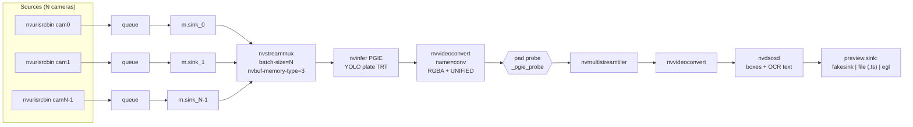
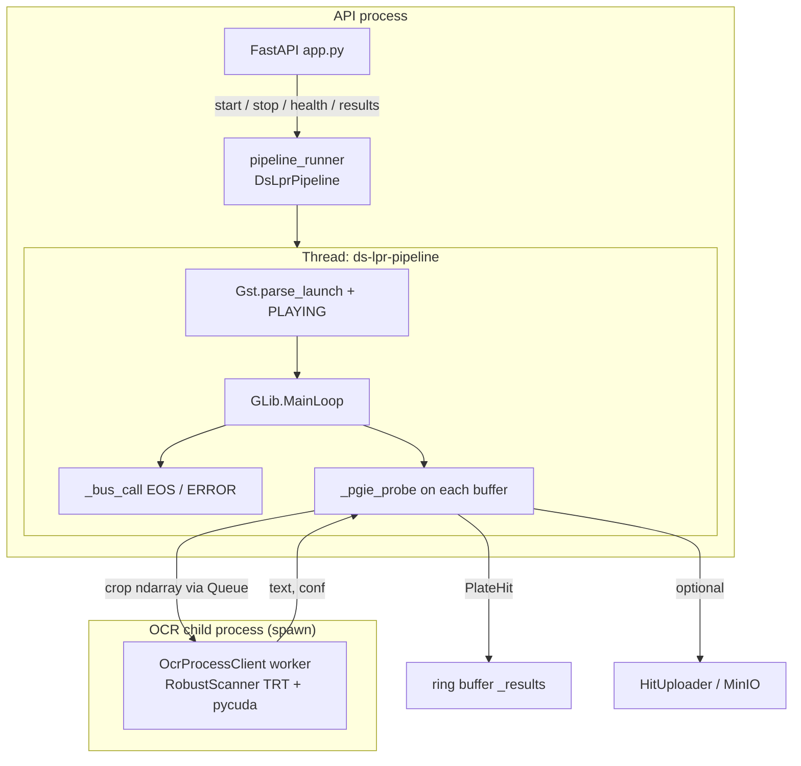
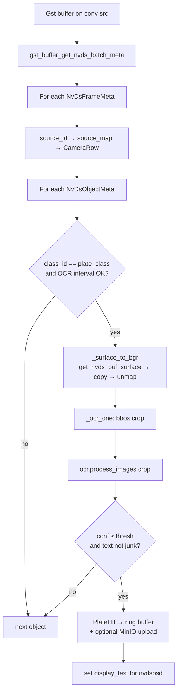
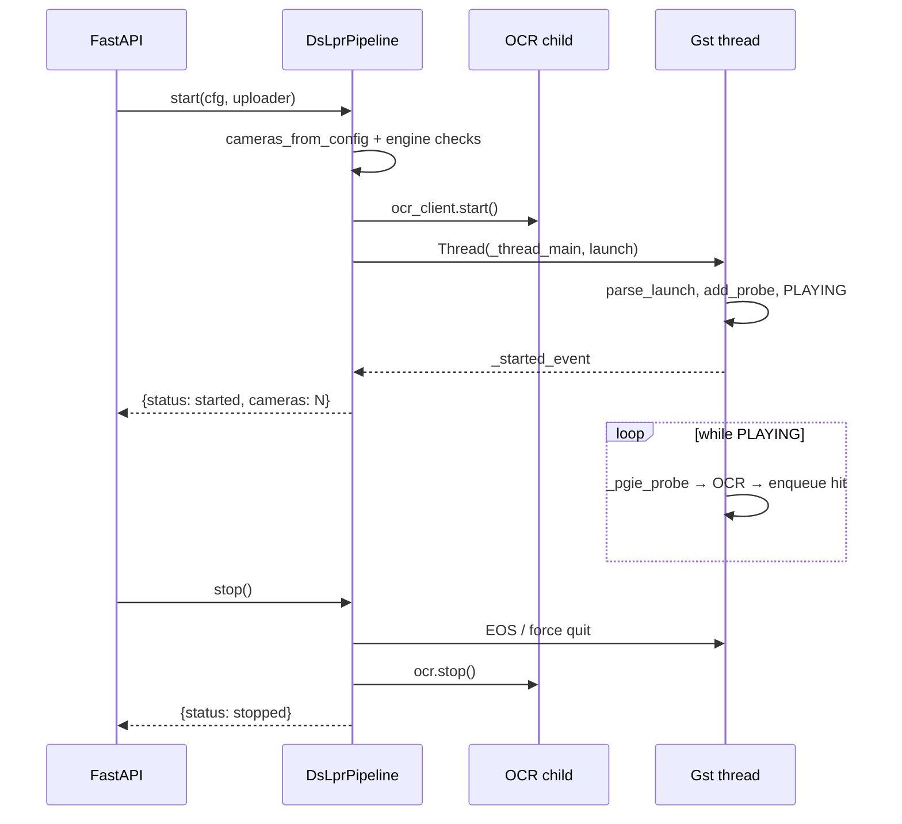

# `pipeline.py` — DeepStream LPR runner

Long-lived DeepStream detect → OCR pipeline used by the FastAPI control plane (`app.py`).  
Builds mux → nvinfer → RGBA → pad probe → tiler → OSD → fakesink from `cameras.yaml`, runs until `stop()`, and pushes plate hits into a ring buffer (optional MinIO upload).

---

## GStreamer graph



Built by `build_launch()`. The probe is attached on **`conv` src pad** (after RGBA), so crops see a CPU-mappable surface.

**Watch overlays:** set `preview.sink: file` and open `output/ds_lpr_preview.ts` in VLC/ffplay (green plate boxes + OCR labels).

---

## Processes and threads



OCR never loads pycuda in the DeepStream process (avoids CUDA-context SIGSEGV).

---

## Pad probe (plate → OCR → hit)



Camera identity always comes from `frame_meta.source_id` (mux sink index), not from frame arrival order.

---

## Camera → `source_id` map

```text
cameras.yaml order          nvstreammux              probe
─────────────────          ─────────────            ─────
cameras[0]  ──►  nvurisrcbin → m.sink_0  ──►  source_id = 0  →  cam_id / bucket
cameras[1]  ──►  nvurisrcbin → m.sink_1  ──►  source_id = 1  →  cam_id / bucket
cameras[i]  ──►  nvurisrcbin → m.sink_i  ──►  source_id = i  →  cam_id / bucket
```

Parsed by `cameras_from_config()` into `CameraRow(source_id, cam_id, url, bucket)`.

---

## Start / stop lifecycle



---

## Main types and API

| Symbol | Role |
|--------|------|
| `CameraRow` | One camera: `source_id`, `cam_id`, `url`, `bucket` |
| `PlateHit` | Accepted OCR result for `/results` |
| `_Runtime` | Probe state: OCR client, uploader, counters, `source_map` |
| `HitUploader` | Protocol for MinIO (or other) upload |
| `DsLprPipeline` | start/stop/health/get_results + Gst thread |
| `pipeline_runner` | Process-wide singleton used by `app.py` |
| `build_launch()` | gst-launch string (UNIFIED mem + RGBA) |
| `_surface_to_bgr()` | Map NVMM RGBA → BGR numpy (needs `nvbuf-memory-type=3`) |
| `_pgie_probe()` | Per-buffer detect meta → crop → OCR → hit |

### Public methods

```text
start(cfg, uploader=None)  →  {status, cameras}
stop(timeout=30)           →  {status}
health()                   →  running, frames, plate_dets, ocr_*
get_results(limit=50)      →  newest PlateHit dicts
```

---

## Why UNIFIED + RGBA

| Setting | Value | Reason |
|---------|--------|--------|
| `nvbuf-memory-type` | `3` (`CUDA_UNIFIED`) | `pyds.get_nvds_buf_surface` safe on dGPU |
| Format before probe | `RGBA` | Required layout for surface map |
| OCR process | spawn child | Isolates TRT/pycuda from DeepStream CUDA |

Wrong memory type or format → surface-map segfault. In-process OCR → CUDA-context segfault (fixed via `ocr_proc.py`).

---

## Related files

| File | Relation to `pipeline.py` |
|------|---------------------------|
| `cameras.yaml` | Config consumed by `start()` |
| `ocr_proc.py` | OCR child client (`OcrProcessClient`) |
| `minio_sink.py` | Implements `HitUploader` |
| `app.py` | Calls `pipeline_runner` |
| `plate_pipeline/config_infer_primary_plate.txt` | `nvinfer` engine / parser config |
| `README.md` | Service-wide architecture and ops |
